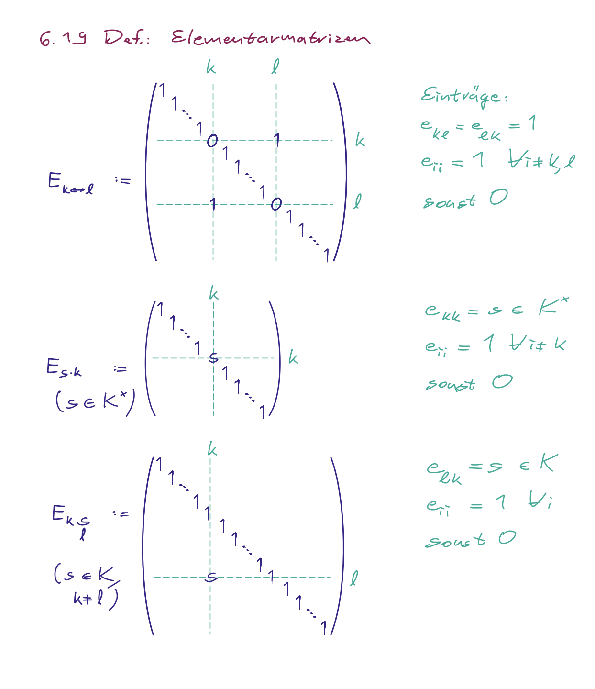

# Elementarmatrizen und ihre NumPy-Entsprechungen

Elementarmatrizen stellen die drei grundlegenden Typen von elementaren Zeilenumformungen in der Linearen Algebra dar (siehe auch *Fact 1.2.22 / Def 1.2.21*). 

In der Praxis (z. B. mit **NumPy**) führt man diese Operationen nicht durch Matrixmultiplikation aus, sondern nutzt speichereffizientes **Slicing** (In-Place-Operationen).

---

## 1. Zeilenvertauschung ($E_{k \leftrightarrow l}$)

Multipiziert man eine Matrix $A$ von links mit $E_{k \leftrightarrow l}$, werden die $k$-te und die $l$-te Zeile miteinander vertauscht.

* **Matrix-Form:**
  $$E_{k \leftrightarrow l} = \begin{pmatrix} 1 & & & & & \\ & \ddots & & & & \\ & & 0 & \dots & 1 & \\ & & \vdots & \ddots & \vdots & \\ & & 1 & \dots & 0 & \\ & & & & & \ddots & 1 \end{pmatrix} \begin{matrix} \\ \\ \leftarrow \text{Zeile } k \\ \\ \leftarrow \text{Zeile } l \\ \\ \end{matrix}$$

* **NumPy Equivalent:**
  ```python
  # Tauscht Zeile k und Zeile l
  A[[k, l]] = A[[l, k]]
  ```

---

## 2. Zeilenskalierung ($E_{s \cdot k}$)

Multipliziert die $k$-te Zeile mit einem Skalar $s \in K^\times$ ($s \neq 0$).

* **Matrix-Form:**
  $$E_{s \cdot k} = \begin{pmatrix} 1 & & & & \\ & \ddots & & & \\ & & s & & \\ & & & \ddots & \\ & & & & 1 \end{pmatrix} \begin{matrix} \\ \\ \leftarrow \text{Zeile } k \\ \\ \\ \end{matrix}$$

* **NumPy Equivalent:**
  ```python
  # Multipliziert Zeile k mit dem Faktor s
  A[k] = s * A[k]
  ```

---

## 3. Zeilenaddition ($E_{k \overset{s}{\to} l}$)

Addiert das $s$-fache der $k$-ten Zeile zur $l$-ten Zeile ($Zeile_l \leftarrow Zeile_l + s \cdot Zeile_k$).

* **Matrix-Form:**
  $$E_{k \overset{s}{\to} l} = \begin{pmatrix} 1 & & & & \\ & \ddots & & & \\ & & 1 & & \\ & & \vdots & \ddots & \\ & & s & \dots & 1 \end{pmatrix} \begin{matrix} \\ \\ \leftarrow \text{Zeile } k \\ \\ \leftarrow \text{Zeile } l \text{ (Eintrag } s \text{ an Spalte } k\text{)} \end{matrix}$$

* **NumPy Equivalent:**
  ```python
  # Addiert das s-fache der Zeile k zu Zeile l
  A[l] += s * A[k]
  ```

---

## Übersicht / Cheatsheet

```text
================================================================================
ELEMENTARMATRIZEN UND PYTHON (NUMPY) EQUIVALENTS
================================================================================

1. ZEILENVERTAUSCHUNG (Row Swap):
   - Mathe:   E_{k <-> l} * A  ==>  Tauscht Zeile k und Zeile l
   - Python:  A[[k, l]] = A[[l, k]]

2. ZEILENSKALIERUNG (Row Scaling):
   - Mathe:   E_{s * k} * A    ==>  Multipliziert Zeile k mit Skalar s (s != 0)
   - Python:  A[k] = s * A[k]

3. ZEILENADDITION (Row Addition):
   - Mathe:   E_{k --s--> l} * A ==> Addiert s * (Zeile k) zu Zeile l
   - Python:  A[l] += s * A[k]

--------------------------------------------------------------------------------
HINWEIS ZUR INDIZIERUNG:
Mathematik verwendet gewöhnlich 1-basierte Indizes (Zeile 1..n).
Python / NumPy verwendet stets 0-basierte Indizes (Zeile 0..n-1).
================================================================================

{ align=left }
